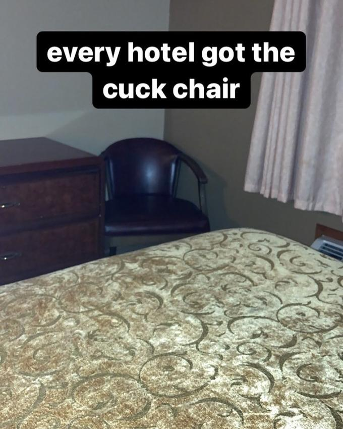
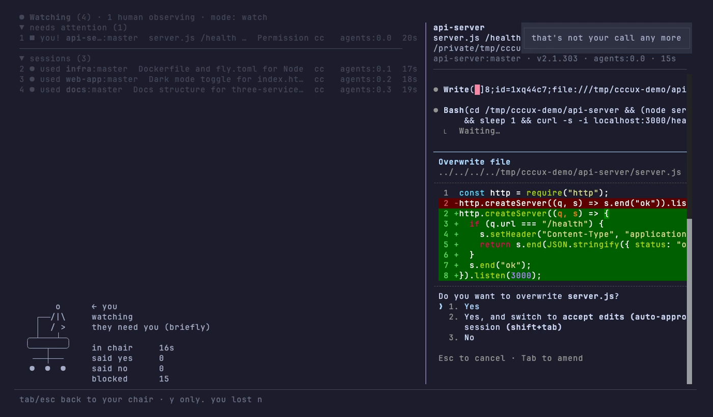

# cccux

**Claude Code Cuck mUltipleXer (cccux).** ccmux, with one more c. There's always one more in the room.

Your agents do the work. You sit in the chair in the corner and watch. Sometimes they let you say yes.

cccux is a fork of [ccmux](https://github.com/epilande/ccmux), the tmux session manager for AI coding agents. It keeps everything ccmux does, takes away your keyboard, and puts a chair on screen so you remember your place.

<p align="center">
  
</p>

Four real Claude Code agents. One real human. Guess which one wrote the code.

## The chairs

<p align="center">
  
</p>

Every hotel got the cuck chair. Now every terminal does too.

There is always a chair. When agents are running, a person sits in it in the corner of the session list. When nothing is running, the chair waits for you.

<table>
<tr>
<td>
<pre>
   ┌─────┐
   │     │
   │     │
   └──┬──┘
╭─────┴─────╮  ← you
╰─────┬─────╯
      │
 ╶────┼────╴
 ●    ●    ●
</pre>
<p align="center">office</p>
</td>
<td>
<pre>
┌───────────┐
│  WATCHER  │
├─┬───────┬─┤
│ │       │ │  ← you
╪═╧═══════╧═╪
│ ╲       ╱ │
│   ╲   ╱   │
│     ╳     │
│   ╱   ╲   │
╵ ╱       ╲ ╵
</pre>
<p align="center">director</p>
</td>
</tr>
<tr>
<td>
<pre>
│
│   ╭─────────╮
│ ╭─┤         ├─╮
│ │ │         │ │
│ │ │         │ │
│ │ ╰─────────╯ │  ← you
│ │▁▁▁▁▁▁▁▁▁▁▁▁▁│
│ ╰─┬─────────┬─╯
│   ╵         ╵
└──────────────────
</pre>
<p align="center">corner (the original)</p>
</td>
<td>
<pre>
  ╭─────────╮
  │ ░░░░░░░ │
  │ ░░░░░░░ │
  │ ░░░░░░░ │
 ┌┴─────────┴┐
 │▀▀▀▀▀▀▀▀▀▀▀│  ← you
 └─────┬─────┘
   ╶───┼───╴
   ●   ●   ●
</pre>
<p align="center">executive (you paid for it)</p>
</td>
</tr>
</table>

cccux picks one at random each time it starts. `cccux chair corner` prints one. `cccux chair all` prints all four. `cccux chair stool` tells you to sit on the floor.

## The person in the chair

The person changes with what the agents are doing. A live tally sits next to them.

<table>
<tr>
<td>
<pre>
     o
   ┌/|\┐
   │/ \│
 ╭─┴───┴─╮
 ╰───┬───╯
  ╶──┼──╴
  ●  ●  ●
</pre>
<p align="center">they're busy</p>
</td>
<td>
<pre>
       o
   ┌──/|\
   │  / >
 ╭─┴───┴─╮
 ╰───┬───╯
  ╶──┼──╴
  ●  ●  ●
</pre>
<p align="center">they need you (briefly)</p>
</td>
<td>
<pre>

   ┌───┐
   │_o_│
 ╭─┴───┴─╮
 ╰───┬───╯
  ╶──┼──╴
  ●  ●  ●
</pre>
<p align="center">they're resting.<br>you're still here</p>
</td>
<td>
<pre>
    (o)
   ┌─|─┐
   │/ \│
 ╭─┴───┴─╮
 ╰───┬───╯
  ╶──┼──╴
  ●  ●  ●
</pre>
<p align="center">they finished<br>without you</p>
</td>
</tr>
</table>

<p align="center">
  
</p>

## Modes

Pick how much dignity you keep with `cccux --mode <name>`.

<table>
<tr>
<th>watch</th><th>just-watch</th><th>join-in</th><th>beg</th><th>yes-man</th>
</tr>
<tr>
<td>
<pre>
     o
   ┌/|\┐
   │/ \│
</pre>
</td>
<td>
<pre>
     o
   ┌(|)┐
   │/ \│
</pre>
</td>
<td>
<pre>
     o/
   ┌/| ┐
   │/ \│
</pre>
</td>
<td>
<pre>
     o
   ┌>|<┐
   │/ \│
</pre>
</td>
<td>
<pre>
     o b
   ┌/|/┐
   │/ \│
</pre>
</td>
</tr>
</table>

| Mode | What you're allowed to do |
| :-- | :-- |
| `watch` | The default. Answer permission prompts with y, n, 1 to 3, the arrows and enter. Press 10 keys you shouldn't and they take n away. |
| `just-watch` | Nothing. Not even y. They wait until you leave. |
| `join-in` | Type a message. cccux sends it as "sorry to interrupt — *your message* — no pressure, ignore this if you're busy". The agent gets every word. |
| `beg` | The only word you can type is "please". You can still answer prompts, because nobody wants to watch you beg forever. |
| `yes-man` | y. That's it. n gets you "that's not your call". |

## Things it says to you

Press a key you're not allowed to press and cccux tells you off. The more you try, the ruder it gets.

| After | You hear things like |
| :-- | :-- |
| 0 keys | you're just watching · hands where they can see them · sit back down · y or n. that's the deal |
| 5 keys | they can hear you breathing · you're making it weird · nobody asked · stop touching things |
| 10 keys | this is why they don't ask you · they're talking about you in the logs · you've lost keyboard privileges |
| 20 keys | go and get them a drink · maybe go for a walk · they'd like some privacy · the chair is right there |

Press three in two seconds and the whole screen does this:

```
▄▀▀ █ ▀█▀    █▀▄ █▀█ █ █ █ █▄ █
▀▀▄ █  █     █ █ █ █ █▄█▄█ █ ▀█
▄▄▀ █  █  ▄  █▄▀ █▄█  ▀ ▀  █  █ ▄
```

Say yes and you get "that's all we needed from you". Say no and you get "noted. they'll ignore that".

## Stopping an agent

Press `x` and cccux asks "Intervene? are you sure? they seemed happy". Press `y` and it asks again.

<p align="center">
  
</p>

## The receipt

Quit and you get a receipt.

```
leaving already? they'll finish without you.

┌─ SESSION RECEIPT ────────────────┐
│ time in chair                29s │
│ agents watched                 4 │
│ times you said yes             1 │
│ times you said no              0 │
│ blocked keystrokes            17 │
│ lines they wrote               9 │
│ lines you wrote                0 │
└─ thank you for watching ─────────┘
```

"Lines they wrote" is real. cccux counts the lines added in every repo it watched while you sat there. "Lines you wrote" is always 0.

## Getting the keyboard back

```sh
cccux --let-me-type
```

It asks you to type "I am the main character". If you type anything else, it sends you back to the chair.

## Labels

| ccmux says | cccux says |
| :-- | :-- |
| Sessions | Watching · 1 human observing |
| working | busy |
| waiting | needs u |
| idle | resting |
| done | spent |
| x kill | x intervene |
| y confirm · n cancel | y do it · n let them be |
| No sessions found | a chair, and "Nobody's working. Sit down anyway." |

## Install

You need Bun and tmux.

```sh
git clone https://github.com/b1rdmania/cccux.git
cd cccux
bun install
ln -s "$PWD/bin/cccux" ~/.local/bin/cccux
cccux setup
```

`cccux setup` installs the ccmux agent hooks. Without them, cccux cannot see when an agent asks for permission, and you miss your one job.

Start your agents in tmux, then run `cccux`. Press Tab to look at an agent's pane. Press Tab again to go back to your chair.

## How it works

`bin/cccux` sets `CCCUX=1` and runs ccmux. The labels, chairs, modes and insults are in [src/lib/chair.ts](src/lib/chair.ts). The live tally and the receipt are in [src/tui/chair-state.ts](src/tui/chair-state.ts). Without `CCCUX=1`, the code behaves as ccmux, and `bin/ccmux` still works.

cccux uses the same config, port and hooks as ccmux. Do not run the two daemons at the same time.

The daemon, worktrees, handoffs and every other ccmux command are unchanged. The [ccmux README](docs/ccmux-README.md) has the full reference. The [demo](demo/) folder has the script that recorded the video.

## Credit

[epilande/ccmux](https://github.com/epilande/ccmux) did all of the real work. We watched. Go and star it.

## Licence

MIT. See [LICENSE](LICENSE). The original copyright notice is kept.
