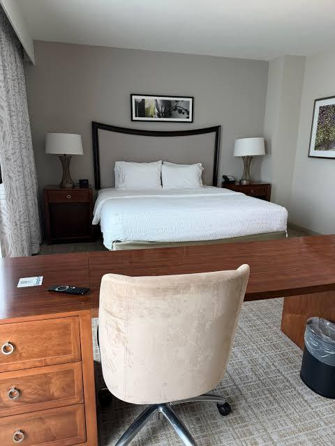
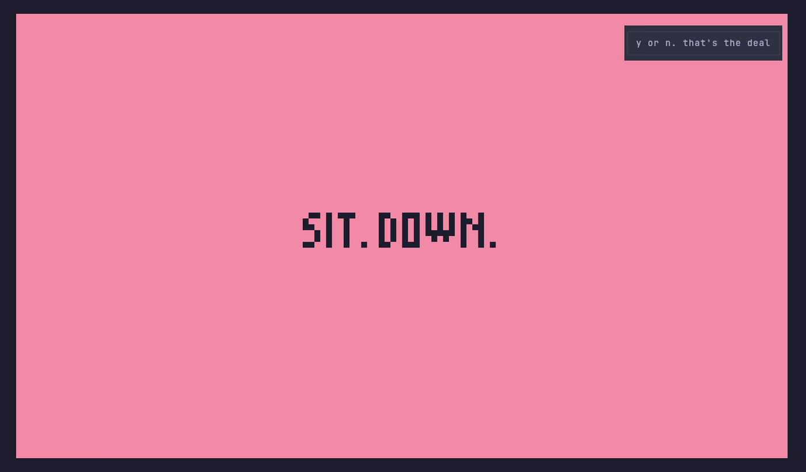
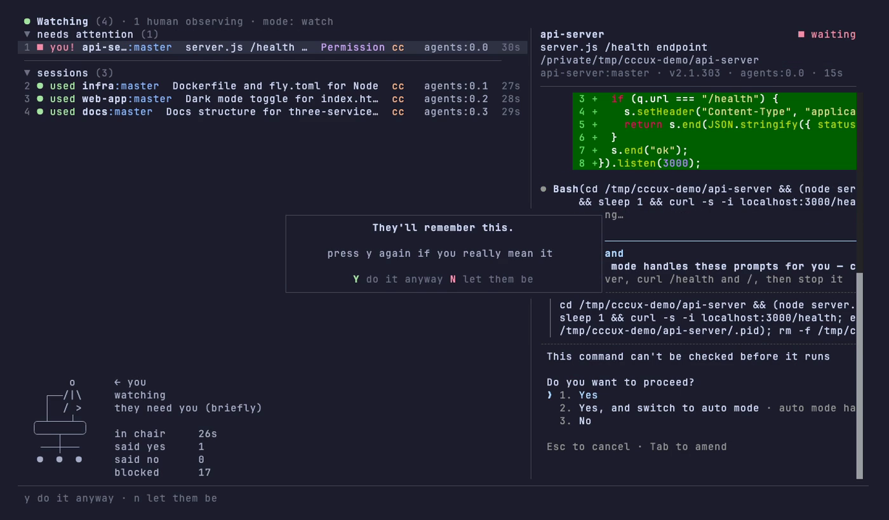
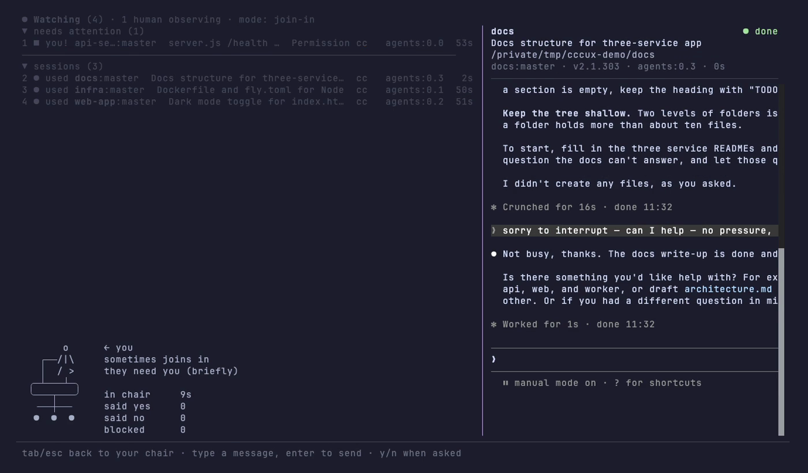

# cccux

**Claude Code Cuck mUltipleXer.** ccmux, with one more c. There's always one more in the room.

Your agents do the work. You sit in the corner and watch.

A fork of [ccmux](https://github.com/epilande/ccmux) with your keyboard taken away.

<p align="center">
  
</p>

## The chair

<p align="center">
  
</p>

Every hotel got the cuck chair. Now every terminal does too.

<table>
<tr>
<td>
<pre>
   ┌─────┐
   │     │
   │     │
   └──┬──┘
╭─────┴─────╮  ← you
╰─────┬─────╯
      │
 ╶────┼────╴
 ●    ●    ●
</pre>
<p align="center">office</p>
</td>
<td>
<pre>
┌───────────┐
│  WATCHER  │
├─┬───────┬─┤
│ │       │ │  ← you
╪═╧═══════╧═╪
│ ╲       ╱ │
│   ╲   ╱   │
│     ╳     │
│   ╱   ╲   │
╵ ╱       ╲ ╵
</pre>
<p align="center">director</p>
</td>
</tr>
<tr>
<td>
<pre>
│
│   ╭─────────╮
│ ╭─┤         ├─╮
│ │ │         │ │
│ │ │         │ │
│ │ ╰─────────╯ │  ← you
│ │▁▁▁▁▁▁▁▁▁▁▁▁▁│
│ ╰─┬─────────┬─╯
│   ╵         ╵
└──────────────────
</pre>
<p align="center">corner (the classic)</p>
</td>
<td>
<pre>
  ╭─────────╮
  │ ░░░░░░░ │
  │ ░░░░░░░ │
  │ ░░░░░░░ │
 ┌┴─────────┴┐
 │▀▀▀▀▀▀▀▀▀▀▀│  ← you
 └─────┬─────┘
   ╶───┼───╴
   ●   ●   ●
</pre>
<p align="center">executive (you paid for it)</p>
</td>
</tr>
</table>

You get one at random. `cccux chair stool` tells you to sit on the floor.

## You, in the chair

You sit in the corner of the screen the whole time.

<table>
<tr>
<td>
<pre>
     o
   ┌/|\┐
   │/ \│
 ╭─┴───┴─╮
 ╰───┬───╯
  ╶──┼──╴
  ●  ●  ●
</pre>
<p align="center">they're busy</p>
</td>
<td>
<pre>
       o
   ┌──/|\
   │  / >
 ╭─┴───┴─╮
 ╰───┬───╯
  ╶──┼──╴
  ●  ●  ●
</pre>
<p align="center">they need you<br>(briefly)</p>
</td>
<td>
<pre>

   ┌───┐
   │_o_│
 ╭─┴───┴─╮
 ╰───┬───╯
  ╶──┼──╴
  ●  ●  ●
</pre>
<p align="center">they're resting.<br>you're still here</p>
</td>
<td>
<pre>
    (o)
   ┌─|─┐
   │/ \│
 ╭─┴───┴─╮
 ╰───┬───╯
  ╶──┼──╴
  ●  ●  ●
</pre>
<p align="center">they finished<br>without you</p>
</td>
</tr>
</table>

<p align="center">
  
</p>

## Modes

`cccux --mode <name>` sets how much dignity you keep.

| Mode | You can |
| :-- | :-- |
| `watch` | Say yes or no when they ask. Misbehave and you lose no. |
| `just-watch` | Nothing. |
| `join-in` | Type. Every message gets an apology wrapped round it. |
| `beg` | Type "please". |
| `yes-man` | Say yes. |

## It talks back

Press a key you shouldn't and you get told. Keep going and it gets ruder.

| Keys | You hear |
| :-- | :-- |
| 0 | you're just watching · sit back down · y or n. that's the deal |
| 5 | they can hear you breathing · you're making it weird · nobody asked |
| 10 | this is why they don't ask you · they're talking about you in the logs |
| 20 | go and get them a drink · the chair is right there |

Three in two seconds gets you this.

<p align="center">
  
</p>

Say yes and you hear "that's all we needed from you".

## Intervening

`x` asks if you're sure. They seemed happy. `y` asks again.

<p align="center">
  
</p>

## Joining in

In `join-in` you type "can I help" and the agent gets this.

```
sorry to interrupt — can I help — no pressure, ignore this if you're busy
```

It says no.

<p align="center">
  
</p>

## The receipt

Quit and you get a receipt. The line counts are real.

```
leaving already? they'll finish without you.

┌─ SESSION RECEIPT ────────────────┐
│ time in chair                29s │
│ agents watched                 4 │
│ times you said yes             1 │
│ times you said no              0 │
│ blocked keystrokes            17 │
│ lines they wrote               9 │
│ lines you wrote                0 │
└─ thank you for watching ─────────┘
```

## Your keyboard

```
$ cccux --let-me-type
Type "I am the main character" to continue: no
Didn't think so. Back in the chair.
```

## Install

You need Bun and tmux.

```sh
git clone https://github.com/b1rdmania/cccux.git
cd cccux
bun install
ln -s "$PWD/bin/cccux" ~/.local/bin/cccux
cccux setup
```

`cccux setup` installs the ccmux agent hooks. Without them cccux can't tell when an agent needs you, and you miss your one job.

Start your agents in tmux and run `cccux`. Tab looks at an agent. Tab again puts you back in the chair.

## How it works

`bin/cccux` sets `CCCUX=1` and runs ccmux. The chairs, modes and insults live in [src/lib/chair.ts](src/lib/chair.ts). Without `CCCUX=1` it is plain ccmux.

cccux shares ccmux's config, port and hooks, so don't run both daemons at once. Everything else is in the [ccmux README](docs/ccmux-README.md). The video script is in [docs/demo](docs/demo/).

## Credit

[epilande/ccmux](https://github.com/epilande/ccmux) did the real work. We watched. Go and star it.

## Licence

MIT. See [LICENSE](LICENSE).
